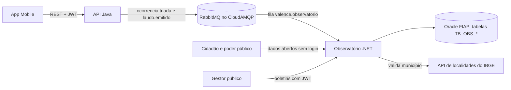

# Valence · Observatório Fitossanitário (.NET)

API em ASP.NET Core Minimal API do **Observatório Fitossanitário** do Valence, a rede pública e colaborativa de vigilância fitossanitária para pequenos produtores de milho, tomate e batata.

Global Solution FIAP 2026/2 · Tema **CitizenTech** · Disciplina **Advanced Business Development with .NET**

Repositório: https://github.com/Valence-Team/valence-dotnet

## Integrantes

| Nome | RM | Papel no Valence |
| --- | --- | --- |
| Guilherme Macedo | 562396 | Observatório .NET (esta API) e banco de dados |
| Henrique Martins | 563620 | API Java, app Mobile, serviço de IA e DevOps |
| Pedro Henrique | 563405 | Qualidade, testes e compliance |

## O problema e a solução

Comunidades rurais descobrem pragas tarde, sem técnico por perto e sem um canal rápido entre vizinhos e poder público. No Valence, o produtor registra o dano na lavoura pelo app, a IA faz a triagem e um agrônomo confirma ou descarta o caso.

O Observatório é a parte de **transparência** do Valence. Ele recebe esses casos sem nenhum dado pessoal e publica **dados abertos** sobre focos de pragas: onde, em qual cultura, qual praga e com qual severidade. Qualquer cidadão, prefeitura ou órgão de defesa agropecuária consulta esses dados sem login. O gestor público usa o mesmo serviço para publicar **boletins regionais** com orientações.

| ODS | Como o Observatório contribui |
| --- | --- |
| 2 · Fome zero e agricultura sustentável | Divulga focos cedo, o que reduz perdas de safra |
| 9 · Indústria, inovação e infraestrutura | Leva dados estruturados do campo para o poder público |
| 10 · Redução das desigualdades | O pequeno produtor isolado passa a ter acesso à mesma informação que o grande |
| 13 · Ação contra a mudança do clima | Ajuda a acompanhar pragas que se espalham com o clima |

## O que o Observatório faz

- Consome pelo RabbitMQ os eventos `ocorrencia.triada` e `laudo.emitido` da API Java e mantém um foco anonimizado por ocorrência (`SUSPEITA`, `CONFIRMADO` ou `DESCARTADO`).
- Descarta eventos repetidos pelo `eventoId` e recusa mensagens inválidas sem travar a fila.
- Publica dados abertos de focos, com filtros, paginação e HATEOAS, e estatísticas por status, cultura, praga e município.
- Permite que gestores publiquem, editem e removam boletins regionais, com JWT, controle por papel e por autoria, idempotência e validação do município na API de localidades do IBGE.
- Bloqueia boletins com e-mail, telefone ou CPF no título ou no texto, porque o Observatório é público.
- Limita requisições por cliente (HTTP 429) e expõe health checks do banco, do RabbitMQ e do IBGE.

## Arquitetura



O Java nunca chama o Observatório por HTTP. Se o Observatório estiver desligado, os eventos esperam na fila e são processados quando ele volta.

A solução segue a arquitetura em camadas das aulas de .NET:

| Pasta da solução | Projeto | Responsabilidade |
| --- | --- | --- |
| 0 - Presentation | `Valence.Observatorio.API` | Endpoints Minimal API, consumidor RabbitMQ, Swagger, rate limiting, health checks, tratamento de erros |
| 1 - Application | `Valence.Observatorio.Application` | DTOs, validações, mappers, casos de uso e serviço de token |
| 2 - Domain | `Valence.Observatorio.Domain` | Entidades com as regras de negócio, enums, `OperationResult`, exceções e contratos |
| 3 - Infrastructure | `Valence.Observatorio.Infrastructure` | `ApplicationContext` (EF Core + Oracle), repositórios, migrations e serviço do IBGE (RestSharp) |
| 3 - Infrastructure | `Valence.Observatorio.IoC` | `Bootstrap.AddIoC`, com todo o registro de dependências |
| 4 - Tests | `Valence.Observatorio.Tests` | Testes unitários e de integração com xUnit |

## Tecnologias

| Uso | Tecnologia |
| --- | --- |
| API | .NET 8, ASP.NET Core Minimal API |
| Banco | Oracle FIAP com EF Core 8 (`Oracle.EntityFrameworkCore`) e migrations |
| Mensageria | RabbitMQ (CloudAMQP) com `RabbitMQ.Client` 7 em um `BackgroundService` |
| Segurança | JWT Bearer (HS256) e senhas com BCrypt |
| Limitação de requisições | Rate limiting nativo do ASP.NET Core (janela fixa) |
| Monitoramento | Health Checks (Oracle, RabbitMQ e URL do IBGE), Serilog e Application Insights opcional |
| Documentação | Swagger (Swashbuckle) com anotações e exemplos (`Swashbuckle.AspNetCore.Filters`) |
| Integração externa | API de localidades do IBGE com RestSharp |
| Testes | xUnit, Moq, EF Core InMemory e `WebApplicationFactory` |

## Estrutura de pastas

```
Valence.Observatorio.API/
├─ Doc/Samples/      exemplos de requisição e resposta exibidos no Swagger
├─ Endpoints/        AuthEndpoints, PublicoEndpoints, BoletimEndpoints
├─ Errors/           formato de erro do contrato e tratador global de exceções
├─ Extensions/       autenticação, limites, saúde, CORS, JSON, Swagger e OperationResult
├─ Filters/          validação de entrada e filtros do Swagger
├─ Messaging/        conexão e consumidor do RabbitMQ
├─ Serializacao/     datas sempre em UTC no JSON
└─ Program.cs
Valence.Observatorio.Application/
├─ Configs/  Dtos/  Interfaces/  Mappers/  Services/  UseCases/  Validations/
Valence.Observatorio.Domain/
├─ Entities/  Enums/  Errors/  Interfaces/  Rules/
Valence.Observatorio.Infrastructure/
├─ Configs/  Data/ (ApplicationContext e Repositories)  Migrations/  Services/ (IBGE)
Valence.Observatorio.IoC/
└─ Bootstrap.cs
Valence.Observatorio.Tests/
├─ Fakes/  Unidade/ (Domain, Application, Infrastructure, Api)  Integracao/
```

## Como executar

### Pré-requisitos

- [.NET 8 SDK](https://dotnet.microsoft.com/download/dotnet/8.0)
- Ferramenta de migrations: `dotnet tool install --global dotnet-ef --version 8.0.33`
- Usuário e senha do Oracle FIAP
- Opcional: URI do RabbitMQ (CloudAMQP). Sem ela, a API funciona normalmente, só não consome eventos.

### Passo a passo (PowerShell)

1. Clonar o repositório:
   ```powershell
   git clone https://github.com/Valence-Team/valence-dotnet.git
   cd valence-dotnet
   ```
2. Criar o arquivo local de configuração a partir do exemplo. Ele fica fora do Git:
   ```powershell
   Copy-Item Valence.Observatorio.API\appsettings.Development.example.json Valence.Observatorio.API\appsettings.Development.json
   ```
3. Editar `Valence.Observatorio.API\appsettings.Development.json`:
   - em `ConnectionStrings:Oracle`, trocar `SEU_RM` e `SUA_SENHA`;
   - em `Jwt:Secret`, colocar uma chave aleatória com 32 caracteres ou mais. Para gerar uma:
     ```powershell
     $bytes = New-Object byte[] 48; [System.Security.Cryptography.RandomNumberGenerator]::Create().GetBytes($bytes); [Convert]::ToBase64String($bytes)
     ```
   - em `RabbitMq:Uri`, colar a URI `amqps://...` do CloudAMQP, ou deixar vazio.
4. Criar as tabelas no Oracle (só na primeira vez):
   ```powershell
   dotnet ef database update --project Valence.Observatorio.Infrastructure --startup-project Valence.Observatorio.API
   ```
5. Subir a API:
   ```powershell
   dotnet run --project Valence.Observatorio.API
   ```
6. Abrir http://localhost:5080. A raiz redireciona para o Swagger.

Sem o `Jwt:Secret` válido, a API não sobe e mostra a mensagem `Configure Jwt:Secret (variável Jwt__Secret) com pelo menos 32 caracteres.`

### Variáveis de ambiente

Toda chave do `appsettings` pode vir de uma variável de ambiente, com `__` separando as seções. O arquivo `.env.example` lista todas com valores fictícios.

| Variável | Obrigatória | Uso | Padrão |
| --- | --- | --- | --- |
| `ConnectionStrings__Oracle` | sim | Connection string do Oracle | |
| `Jwt__Secret` | sim | Segredo HS256, mínimo de 32 caracteres | |
| `Jwt__Issuer`, `Jwt__Audience` | não | Emissor e audiência do token | `valence-observatorio` |
| `Jwt__ExpiracaoMinutos` | não | Validade do token | `120` |
| `RabbitMq__Uri` | não | URI amqps do CloudAMQP; vazio desliga o consumidor | |
| `RabbitMq__Fila` | não | Fila do Observatório | `valence.observatorio` |
| `Ibge__BaseUrl` | não | API de localidades do IBGE | `https://servicodados.ibge.gov.br/api/v1/` |
| `Ibge__TimeoutSegundos` | não | Tempo limite das consultas ao IBGE | `5` |
| `RateLimiting__Publica__Limite`, `RateLimiting__Publica__JanelaSegundos` | não | Limite dos endpoints públicos por cliente | `60` por `60` s |
| `RateLimiting__Login__Limite`, `RateLimiting__Login__JanelaSegundos` | não | Limite de tentativas de login por cliente | `5` por `60` s |
| `RateLimiting__Escrita__Limite`, `RateLimiting__Escrita__JanelaSegundos` | não | Limite de escrita de boletins por gestor | `20` por `60` s |
| `Cors__Origens` | não | Origens liberadas para navegador, separadas por vírgula | vazio |
| `ApplicationInsights__ConnectionString` | não | Liga a telemetria no Application Insights | vazio |
| `ASPNETCORE_FORWARDEDHEADERS_ENABLED` | só no App Service | Faz o rate limiting enxergar o IP real do cliente atrás do proxy do Azure | `false` |

## Usuários de teste

Criados pela migration inicial, com a senha guardada em hash BCrypt:

| E-mail | Senha | Papel | Pode |
| --- | --- | --- | --- |
| `gestor1@valence.local` | `Valence@Gestor1` | GESTOR | Publicar, editar e remover os próprios boletins |
| `gestor2@valence.local` | `Valence@Gestor2` | GESTOR | Mesmo do gestor1; serve para mostrar o 403 de autoria |
| `agronomo@valence.local` | `Valence@Agro1` | AGRONOMO | Fazer login, mas não escrever boletins (403) |

No Swagger: faça o login em `POST /api/auth/login`, copie o `token`, clique em **Authorize** e cole só o token.

## Endpoints

| Método | Rota | Acesso | Descrição |
| --- | --- | --- | --- |
| POST | `/api/auth/login` | público, limite de login | Login; devolve o JWT |
| GET | `/api/auth/me` | autenticado | Mostra o dono do token |
| GET | `/api/publico/focos` | público, limite público | Focos anonimizados com filtros `cultura`, `uf`, `municipio`, `desde`, `deslocamento`, `registroRetornado` |
| GET | `/api/publico/focos/{id}` | público, limite público | Detalhe de um foco |
| GET | `/api/publico/estatisticas` | público, limite público | Contagens por status, cultura, praga e município (`uf`, `periodo`) |
| GET | `/api/boletins` | público, limite público | Boletins com filtros `uf`, `municipio` e paginação |
| GET | `/api/boletins/{id}` | público, limite público | Detalhe de um boletim |
| POST | `/api/boletins` | GESTOR, `Idempotency-Key`, limite de escrita | Publica um boletim |
| PUT | `/api/boletins/{id}` | GESTOR autor, limite de escrita | Atualiza um boletim |
| DELETE | `/api/boletins/{id}` | GESTOR autor, limite de escrita | Remove um boletim |
| GET | `/health`, `/health/live`, `/health/db`, `/health/externos` | público | Health checks |
| GET | `/swagger` | público | Documentação interativa |

### Exemplos

**Login**

```http
POST /api/auth/login
Content-Type: application/json

{ "email": "gestor1@valence.local", "senha": "Valence@Gestor1" }
```

```json
{ "token": "eyJhbGciOiJIUzI1NiIs...", "tipo": "Bearer", "expiraEm": "2026-11-10T16:32:00Z", "papel": "GESTOR" }
```

**Focos (dados abertos)**

```http
GET /api/publico/focos?cultura=milho&uf=SP&registroRetornado=1
```

```json
{
  "items": [
    {
      "id": 12,
      "cultura": "MILHO",
      "pragaProvavel": "Cigarrinha-do-milho (enfezamento)",
      "severidade": 4,
      "municipio": "Ribeirão Preto",
      "uf": "SP",
      "status": "CONFIRMADO",
      "dataOcorrencia": "2026-11-08T14:20:00Z",
      "atualizadoEm": "2026-11-09T09:10:00Z",
      "links": [
        { "href": "/api/publico/focos/12", "rel": "self", "method": "GET" },
        { "href": "/api/publico/focos", "rel": "focos", "method": "GET" }
      ]
    }
  ],
  "deslocamento": 0,
  "registroRetornado": 1,
  "totalRegistros": 3,
  "links": [
    { "href": "/api/publico/focos?cultura=MILHO&uf=SP&deslocamento=0&registroRetornado=1", "rel": "self", "method": "GET" },
    { "href": "/api/publico/focos?cultura=MILHO&uf=SP&deslocamento=1&registroRetornado=1", "rel": "next", "method": "GET" }
  ]
}
```

**Estatísticas**

```http
GET /api/publico/estatisticas?uf=SP&periodo=30
```

```json
{
  "uf": "SP",
  "periodoDias": 30,
  "desde": "2026-10-11T12:00:00Z",
  "ate": "2026-11-10T12:00:00Z",
  "totalFocos": 4,
  "porStatus": [ { "chave": "SUSPEITA", "total": 3 }, { "chave": "CONFIRMADO", "total": 1 } ],
  "porCultura": [ { "chave": "MILHO", "total": 3 }, { "chave": "TOMATE", "total": 1 } ],
  "porPraga": [ { "chave": "Cigarrinha-do-milho (enfezamento)", "total": 3 }, { "chave": "Requeima", "total": 1 } ],
  "porMunicipio": [ { "chave": "Ribeirão Preto/SP", "total": 3 }, { "chave": "Campinas/SP", "total": 1 } ],
  "links": [
    { "href": "/api/publico/estatisticas?uf=SP&periodo=30", "rel": "self", "method": "GET" },
    { "href": "/api/publico/focos?uf=SP&desde=2026-10-11T12%3A00%3A00Z", "rel": "focos", "method": "GET" }
  ]
}
```

**Publicar boletim**

```http
POST /api/boletins
Authorization: Bearer <token do gestor>
Idempotency-Key: 3f6c1e2a-8b4d-4e9a-9c1f-2d7e5a6b8c90
Content-Type: application/json

{
  "municipio": "ribeirao preto",
  "uf": "sp",
  "titulo": "Alerta de cigarrinha-do-milho na região",
  "texto": "Foram confirmados focos de enfezamento do milho. Vistorie a lavoura e procure a Casa da Agricultura."
}
```

Resposta `201 Created`, com `Location: /api/boletins/3`:

```json
{
  "id": 3,
  "municipio": "Ribeirão Preto",
  "uf": "SP",
  "titulo": "Alerta de cigarrinha-do-milho na região",
  "texto": "Foram confirmados focos de enfezamento do milho. Vistorie a lavoura e procure a Casa da Agricultura.",
  "gestorId": 1,
  "criadoEm": "2026-11-10T13:00:00Z",
  "atualizadoEm": null,
  "links": [
    { "href": "/api/boletins/3", "rel": "self", "method": "GET" },
    { "href": "/api/boletins/3", "rel": "atualizar", "method": "PUT" },
    { "href": "/api/boletins/3", "rel": "remover", "method": "DELETE" },
    { "href": "/api/boletins", "rel": "boletins", "method": "GET" }
  ]
}
```

**Erro (formato único da API)**

```json
{
  "timestamp": "2026-11-10T14:32:00Z",
  "status": 400,
  "erro": "Requisição inválida",
  "mensagem": "Um ou mais campos são inválidos.",
  "caminho": "/api/boletins",
  "campos": [ { "campo": "titulo", "mensagem": "O título é obrigatório." } ]
}
```

### Códigos HTTP

| Código | Quando |
| --- | --- |
| 200 | Consulta, login ou atualização com sucesso |
| 201 | Boletim publicado, com o cabeçalho `Location` |
| 204 | Lista sem resultados ou boletim removido |
| 400 | Campo inválido, parâmetro com tipo errado ou `Idempotency-Key` ausente ou fora do formato UUID |
| 401 | Sem token, token inválido ou expirado, ou e-mail e senha errados |
| 403 | Papel sem permissão (AGRONOMO escrevendo) ou gestor que não é o autor do boletim |
| 404 | Foco, boletim ou rota inexistente |
| 409 | `Idempotency-Key` já usada com outro conteúdo |
| 422 | Município que não existe na UF, ou título ou texto com e-mail, telefone ou CPF |
| 429 | Limite de requisições excedido, com o cabeçalho `Retry-After` |
| 500 | Erro inesperado, sem detalhes internos na resposta |
| 503 | API do IBGE indisponível |

## Idempotência

**Boletins.** O `POST /api/boletins` exige o cabeçalho `Idempotency-Key` com um UUID gerado pelo cliente. A API guarda a chave, um hash SHA-256 do conteúdo (gestor, município, UF, título e texto) e a resposta original:

| Situação | Resposta |
| --- | --- |
| Chave nova | Cria o boletim e devolve `201` |
| Mesma chave e mesmo conteúdo | Devolve a resposta original, com `Idempotency-Replayed: true`, sem criar outro boletim |
| Mesma chave com outro conteúdo | `409` |
| Duas requisições iguais ao mesmo tempo | A segunda esbarra na chave única do banco e recebe a resposta da primeira |

O boletim e a resposta guardada são gravados na mesma transação.

**Eventos do RabbitMQ.** A entrega é "pelo menos uma vez". Cada evento processado fica registrado pelo `eventoId`, e um evento repetido é descartado sem efeito. O foco e o registro do evento são gravados no mesmo `SaveChanges`.

## Rate limiting

Janela fixa por cliente, configurável pelas variáveis `RateLimiting__*`:

| Política | Onde | Chave | Padrão |
| --- | --- | --- | --- |
| `publica` | `/api/publico/*` e `GET /api/boletins` | IP do cliente | 60 requisições por minuto |
| `login` | `POST /api/auth/login` | IP do cliente | 5 tentativas por minuto |
| `escrita` | `POST`, `PUT` e `DELETE` de boletins | Usuário do token | 20 requisições por minuto |

Acima do limite, a resposta é `429` no formato de erro da API, com o cabeçalho `Retry-After` em segundos.

Para demonstrar, rode a API com um limite baixo:

```powershell
$env:RateLimiting__Publica__Limite = "5"; dotnet run --project Valence.Observatorio.API
```

E em outra janela:

```powershell
1..7 | ForEach-Object { curl.exe -s -o NUL -w "%{http_code}`n" http://localhost:5080/api/publico/focos }
```

As 5 primeiras respondem `200` ou `204`, e as seguintes `429`.

## Health checks

| Rota | Verifica | Status |
| --- | --- | --- |
| `/health/live` | Só o processo da API | 200 |
| `/health/db` | Oracle (`SELECT 1 FROM DUAL`) | 200, ou 503 se o banco estiver fora |
| `/health/externos` | RabbitMQ e API do IBGE | 200 com `Degraded` se algum estiver fora |
| `/health` | Todos | 200 (`Healthy` ou `Degraded`) ou 503 (`Unhealthy`) |

RabbitMQ e IBGE fora do ar deixam a API `Degraded`, e não `Unhealthy`, porque ela continua servindo os dados abertos. Sem `ConnectionStrings__Oracle`, o banco aparece como `Unhealthy`; sem `RabbitMq__Uri`, o RabbitMQ aparece como `Degraded`. A resposta é um JSON com o status geral e cada verificação, sem mensagem de exceção, para não expor detalhes de conexão:

```json
{
  "status": "Degraded",
  "duracaoMs": 412.6,
  "verificacoes": [
    { "nome": "oracle", "status": "Healthy", "descricao": "Disponível", "duracaoMs": 380.2 },
    { "nome": "rabbitmq", "status": "Degraded", "descricao": "Indisponível; a API continua respondendo sem este recurso", "duracaoMs": 0.1 },
    { "nome": "ibge", "status": "Healthy", "descricao": "Disponível", "duracaoMs": 211.4 }
  ]
}
```

## Mensageria (RabbitMQ)

- Exchange `valence.eventos` (topic, durável) e fila `valence.observatorio` (durável), ligada às routing keys `ocorrencia.triada` e `laudo.emitido`. O Observatório declara as duas ao subir.
- Confirmação manual: a mensagem só sai da fila depois de gravada no Oracle.
- Mensagem inválida (JSON quebrado, versão diferente de 1, cultura ou decisão desconhecida) é recusada sem voltar para a fila. Falha temporária (banco fora do ar) devolve a mensagem para a fila depois de 5 segundos.
- Se o RabbitMQ cair, o consumidor tenta reconectar a cada 15 segundos sem derrubar a API.
- Regras do foco: a triagem cria o foco como `SUSPEITA`; o laudo `CONFIRMADA` confirma e grava a praga confirmada; `DESCARTADA` descarta; `MAIS_INFORMACOES` não muda o status. Se o laudo chegar antes da triagem, o foco nasce pelo laudo, e a triagem que chegar depois nunca rebaixa o status.

## Testes automatizados

Os testes não precisam de Oracle nem de RabbitMQ: o banco vira EF Core InMemory e o IBGE é simulado.

```powershell
dotnet test
```

Só uma categoria:

```powershell
dotnet test --filter "Categoria=Unidade"
dotnet test --filter "Categoria=Integracao"
```

| Tipo | O que cobre |
| --- | --- |
| Unitários de domínio | Transições do foco, autoria e dados pessoais no boletim, regras de UF e de texto |
| Unitários de casos de uso (Moq) | Login, token, paginação e estatísticas, eventos (novo, repetido, inválido, fora de ordem, falha temporária) e boletins (idempotência, 409, 422, 503, 403) |
| Unitários de repositório (InMemory) | Filtros, paginação, estatísticas, gravação atômica e idempotência |
| Integração (`WebApplicationFactory`) | Todos os endpoints com 200, 201, 204, 400, 401, 403, 404, 409, 422, 429 e 503, health checks, Swagger, compressão e redirecionamento da raiz |

Todos os testes seguem o padrão Arrange, Act e Assert e são marcados com `[Trait("Categoria", ...)]`.

## Roteiro de demonstração

1. Mostrar no Swagger as seções Autenticação, Dados abertos, Boletins e Saúde.
2. Com a API desligada, publicar eventos no RabbitMQ; ligar a API e mostrar a fila sendo processada e os focos aparecendo em `GET /api/publico/focos`.
3. Filtrar focos por cultura e UF, navegar pelos links `next` e `prev` e abrir as estatísticas.
4. Login como `gestor1`, botão Authorize, publicar um boletim com `municipio` em minúsculas e sem acento (o IBGE devolve o nome oficial).
5. Repetir o mesmo `POST` com a mesma `Idempotency-Key` (`Idempotency-Replayed: true`); mudar o texto com a mesma chave (409).
6. Tentar publicar texto com telefone (422) e município de outra UF (422).
7. Login como `gestor2` e tentar editar o boletim do `gestor1` (403); login como `agronomo` e tentar publicar (403).
8. Mostrar o 429 com o limite baixo e os health checks em `/health`.
9. Rodar `dotnet test`.

## Decisões técnicas

| Decisão | Motivo |
| --- | --- |
| Minimal API em camadas | O PDF pede Minimal API; a separação em projetos segue o padrão das aulas e deixa as regras testáveis sem HTTP nem banco |
| Regras dentro das entidades | Transição de status e autoria ficam no domínio, testadas com `new` puro |
| `OperationResult` e exceções de domínio | O caso de uso traduz a exceção para o código HTTP; um tratador global garante o mesmo formato de erro em qualquer falha |
| Oracle com tabelas `TB_OBS_*` | Banco da FIAP, prefixo próprio para não colidir com as tabelas de outras disciplinas no mesmo schema |
| Enums gravados como texto | O banco fica legível e a ordem dos enums pode mudar sem corromper dados |
| `ocorrenciaId` fora da resposta pública | É o elo com o produtor na API Java; o dado aberto não leva de volta a quem registrou |
| Validação do município no IBGE com cache de 24 h | O boletim sempre traz o nome oficial; o cache evita uma chamada externa por requisição |
| Datas sempre em UTC com `Z` | O Oracle devolve datas sem fuso; um conversor de JSON padroniza a saída |
| JWT próprio, sem e-mail no token | O Observatório roda sem o Java; o token leva só id, papel e expiração |
| Segredo validado na inicialização | A API não sobe com chave fraca ou ausente |
| RabbitMQ e IBGE como `Degraded` | A API continua útil sem eles; só o banco a deixa `Unhealthy` |

## Publicação na nuvem

A publicação no Azure App Service é feita pela disciplina de DevOps. A API já está pronta para isso:

- todas as configurações vêm de variáveis de ambiente (tabela acima);
- `Cors__Origens` libera o Swagger publicado ou um cliente web;
- no App Service, definir `ASPNETCORE_FORWARDEDHEADERS_ENABLED=true` para o rate limiting enxergar o IP real do cliente;
- rodar o `dotnet ef database update` uma vez antes do primeiro acesso.

URL publicada: a preencher após o deploy.

## Uso de IA generativa

Ferramenta: **Claude (Anthropic)**, no chat do projeto do grupo.

| Para quê | Como foi usado |
| --- | --- |
| Planejamento | Divisão do trabalho em etapas a partir dos requisitos do PDF e dos padrões das aulas |
| Código | Sugestões de código para cada etapa, revisadas, compiladas, executadas e testadas pelo integrante antes de cada commit |
| Diagnóstico de erros | Explicação de erros de build, de configuração do Oracle e de dependências de pacotes (por exemplo, a versão do OpenAPI rejeitada pelo Swagger UI) |
| Documentação | Revisão das descrições do Swagger e deste README |
| Estudo | Explicação das decisões de arquitetura, segurança e idempotência para a apresentação |

Todo o conteúdo foi revisado e é de responsabilidade do grupo. Nenhuma credencial real foi compartilhada com a ferramenta.
